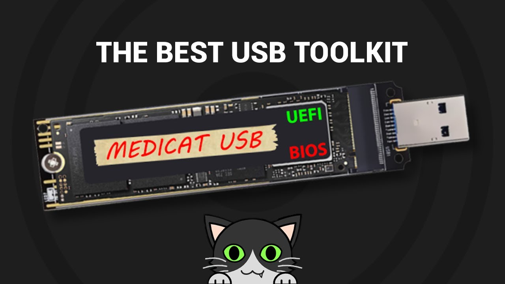

Whether you're the unofficial family IT director like I am, or just someone who feels at home tinkering with hardware, you know the dread well. It usually arrives via a panicked text message or strikes you directly: a monitor goes stubbornly dark, Windows traps itself in a merciless boot cycle, or a rogue update bricks the entire system right as the clock runs out.

In the old days, fixing this meant digging through a CD wallet full of scratched Ubuntu live discs, or juggling five different thumb drives. Today? You really just need one: [MediCat USB](https://medicatusb.com/).

### What is MediCat, Anyway?

Think of MediCat as a massive, digital first-aid kit. Put together by a creator named Jayro and backed by an awesome repair community, it’s the modern, beefed-up successor to classic rescue suites like Hiren’s BootCD. But instead of just giving you a basic command line and wishing you luck, MediCat drops you into a fully functional, lightweight Windows environment (WinPE) that runs entirely off your USB stick.

The absolute best part is how it runs. Modern versions are built on top of Ventoy. Which if you haven't used it, is basically magic. Instead of having to meticulously format and "burn" a flash drive every time a single tool gets an update, Ventoy lets you treat the USB like a normal folder. You just drag and drop your bootable files in, and when you start the PC, you get a clean menu to pick exactly what you need.

### What’s in the Toolkit?

At dozens of gigabytes, it comes packed with pretty much everything you need to bring a dead PC back from the brink:

- **Hardware Checkups:** If a computer is randomly blue-screening, you can run tools like MemTest86+ to see if the RAM is failing, or check the health of a dying hard drive before it clicks its last click.
- **Data Rescue:** Windows absolutely refuses to boot? No problem. Boot into MediCat, browse the file system, and copy your important documents over to an external drive before you nuke the whole system.
- **Malware Scanners:** It’s infinitely easier to clean a stubborn virus when the infected operating system is "asleep" and can't actively block your antivirus software.
- **Admin Tools:** Legitimately forgot a local Windows password? MediCat has offline registry editors and password reset tools that can get you back in without forcing a clean install.

### Why It Beats the "Just Factory Reset It" Advice

There's something really satisfying about fixing a machine that tech support would have just given up on. A lot of modern troubleshooting advice pushes us toward the nuclear option of if the OS is acting up, just wipe the drive and start over.

MediCat gives you your control back. It lets you get under the hood, bypass whatever is broken, and actually fix the root problem. Whether you're trying to salvage a broken boot sector on a server or just rescue your vacation photos from a corrupted laptop, it turns a total disaster into a solvable puzzle.

### The Catch (Because There’s Always One)

To be fair, setting up MediCat takes a little upfront effort. First, it’s _huge_. You’re going to need a spacious, fast USB 3.0 drive (64 GB is recommended, minimum is 30+ GB). Don't try putting this on that cheap 8GB promo stick you got at a conference ten years ago.

Also, your antivirus is almost certainly going to freak out when you download it. Because MediCat includes tools that can bypass passwords and edit core system files, Windows Defender will inevitably flag it as suspicious. Dealing with those false positives is practically a rite of passage for setting it up.

But once you’ve got it loaded onto a sturdy drive and clipped to your backpack, the peace of mind is totally worth it. You might go six months without needing it, but the day your PC decides to give up on life, plugging in that little piece of metal and watching a full recovery dashboard light up the screen feels pretty close to a superpower.
