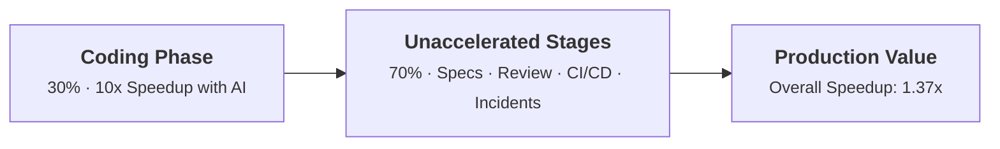
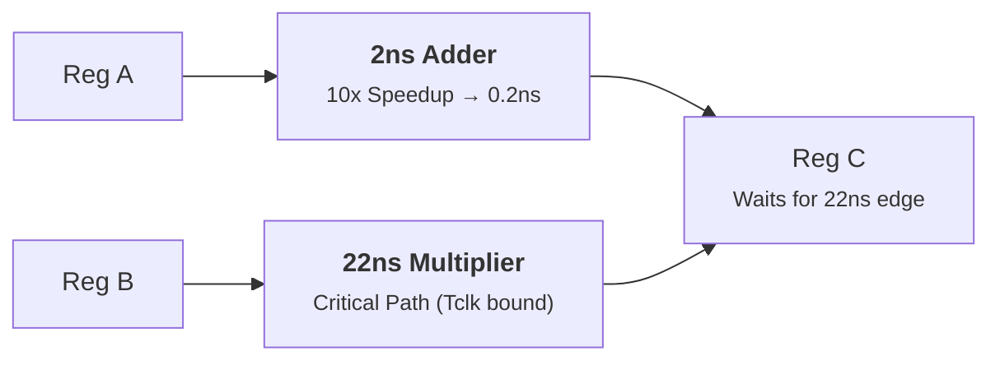
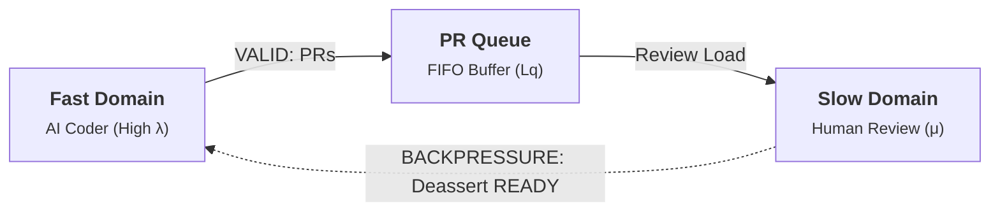
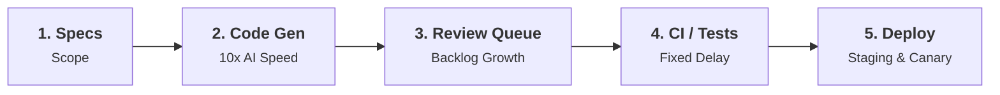
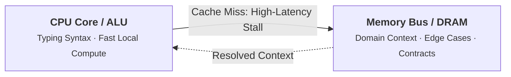
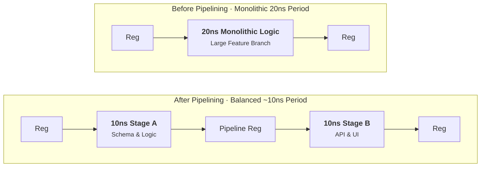

*If AI tools let engineers write code ten times faster, why is your team still shipping at roughly the same pace? The answer was figured out in 1967 by computer architect Gene Amdahl, and it looks a lot like a timing issue on a silicon chip.*

---

A few months ago, a software team got max subscriptions for AI coding tools. Within days, everyone was talking about how fast they were moving. Boilerplate that used to take an hour was done in minutes, unit tests practically wrote themselves, and generating code felt almost effortless. Management started wondering if they were about to see a massive leap in shipping velocity.

Then a quarter passed.

Their two-week sprints were still two weeks. Production releases went out on the same cadence as before. The roadmap still had the same delays. If anything, their GitHub pull request queue looked worse: open PRs were sitting for days waiting for review, while reviewers struggled to digest hundreds of lines of generated diffs.

Everyone was typing faster, but the team was barely shipping faster.

If you have a background in digital logic or computer architecture, this situation will feel familiar. They did not discover a new productivity mystery. But ran straight into Amdahl's Law, the critical path of synchronous circuits, and the consequences of running a pipeline without backpressure.

---

## 1. Amdahl’s Law and the 30% Problem

In 1967, computer architect Gene Amdahl presented a paper on the limits of parallel processing. His point was straightforward: the overall speedup of any system is constrained by the parts you cannot accelerate.

Mathematically, Amdahl’s Law calculates overall system speedup ($S$) as:

$$S = \frac{1}{(1 - p) + \cfrac{p}{s}}$$

Where:

- $p$ is the fraction of total cycle time that can be accelerated.
- $s$ is the speedup factor achieved on that accelerated portion.
- $(1 - p)$ is the unaccelerated portion.

Amdahl's Law assumes a fixed-work model: the total work remains constant, and we simply accelerate a portion of it. In real software teams, AI can also change the nature of the work itself, such as introducing subtle edge-case bugs or encouraging speculative features. But as a baseline model, it reveals why isolated speedups rarely transform end-to-end velocity.

Let us use an illustrative scenario. Assume that writing code accounts for roughly 30% of the calendar time between an initial ticket and production release. The other 70% is consumed by activities outside of raw code authoring:

- Clarifying requirements and defining problem scope
- Coordinating API contracts and architectural decisions
- Reviewing pull requests and discussing design tradeoffs
- Waiting on CI pipelines and investigating flaky tests
- Running staging verifications, database migrations, and canary deploys
- Triaging edge cases and handling production incidents

For greenfield tasks, coding might represent a larger share of the cycle. For enterprise maintenance on mature codebases, it is often much lower. But using 30% as a reasonable baseline, what happens if an AI tool makes the coding phase 10x faster ($s = 10, p = 0.30$)?

$$S = \frac{1}{(1 - 0.30) + \cfrac{0.30}{10}} = \frac{1}{0.70 + 0.03} \approx 1.37\times$$

A 10x boost in typing code yields about a **37% overall speedup** from concept to deployment.

Even in an aggressive scenario where an engineer spends half their total working hours writing code ($p = 0.50$), a 10x speedup in code generation yields:

$$S = \frac{1}{0.50 + 0.05} \approx 1.82\times$$

When non-coding activities account for the majority of the cycle, reducing coding time toward zero still leaves that remaining fraction untouched.

---

## 2. The Critical Path in Digital Logic

In synchronous digital logic design (such as Verilog, VHDL, or ASIC development), circuits consist of sequential state elements (flip-flops) connected by combinational logic paths (adders, multiplexers, and logic gates).

In a simplified register-to-register path, the minimum clock period ($T_{\text{clk}}$) is bounded by the **critical path**: the single longest propagation delay between any two flip-flops:

$$T_{\text{clk}} \ge t_{\text{cq}} + t_{\text{comb(max)}} + t_{\text{setup}} + t_{\text{skew}}$$

Where $t_{\text{cq}}$ is clock-to-Q delay, $t_{\text{comb(max)}}$ is the maximum combinational path delay, $t_{\text{setup}}$ is the register setup time, and $t_{\text{skew}}$ represents clock skew and timing uncertainty.

Consider two parallel paths feeding into a downstream register:

1. Path A has a simple adder with a propagation delay of 2 nanoseconds.
2. Path B has a multiplier with a propagation delay of 22 nanoseconds.

If an engineer optimizes Path A so it computes in 0.2 nanoseconds (a 10x improvement), what happens to the clock frequency of the chip?

Nothing. Path B still takes 22 nanoseconds. Because the clock cycle must accommodate the slowest path between registers, optimizing the 2ns adder does not allow the clock to tick any faster. The faster data simply arrives early at the register and sits idle, waiting for the clock edge.

Software delivery is not a literal circuit: it involves multiple stages, human coordination, and varying dependencies. But the concept of the critical path directly applies. If clarifying a specification takes three days, CI and review take four days, and writing the code takes half a day, typing was never on the critical path. Shrinking the code generation phase does not speed up the release clock.

---

## 3. Pipeline Hazards, Queueing, and Backpressure

Digital systems handle mismatched throughput between stages using pipelines, buffers, and flow control. When a block on a high-speed clock domain transmits data to a block on a slower clock domain, hardware engineers use asynchronous FIFOs with explicit backpressure signals.

In protocols like AXI, the `VALID`/`READY` handshake enforces flow control. A transfer occurs only when both `VALID` and `READY` are asserted on a clock edge. If the downstream consumer is busy or its buffer is full, it deasserts `READY`. This exerts backpressure on the producer, which must hold its data until the consumer can accept it.

If a system lacks flow control and provides inadequate buffering, a fast producer will overwhelm downstream capacity. Depending on the architecture, this leads to buffer overflow, dropped packets, or stalled execution.

In many software teams, there is no backpressure on code generation.

When developers use AI to produce code faster, the arrival rate of pull requests increases. But downstream review capacity, bounded by the number of engineers and their cognitive bandwidth, remains relatively fixed.

This is where queueing dynamics become visible. In a stable queueing system where arrival rate and service rate are balanced over time, **Little’s Law** describes the relationship between average work in progress, throughput, and average waiting time:

$$L_q = \lambda \times W_q \quad \implies \quad W_q = \frac{L_q}{\lambda}$$

Where:

- $L_q$ is the average number of PRs waiting in the review queue.
- $\lambda$ is the steady-state throughput (PRs reviewed and merged per day).
- $W_q$ is the average waiting time a PR spends in the queue.

Little's Law applies to stable systems in long-run equilibrium. But when incoming code generation persistently outpaces review capacity ($\lambda_{\text{in}} > \mu$), the system becomes non-stationary. The queue grows without settling into a steady state, and waiting time increases rapidly.

This dynamic introduces specific failure modes:

1. Review fatigue: Reviewers face larger, more frequent diffs, increasing the temptation to skim or rubber-stamp code.
2. Context-switching cost: As PR wait times grow, authors must reload context on pull requests submitted days or weeks earlier.
3. Latent defect risk: Code generated with less manual inspection can contain subtle logic errors that pass unit tests but fail under integration load.
4. Debugging overhead: When production bugs occur, engineers spend more time diagnosing code they did not write line by line.

Unchecked upstream code generation without matching review capacity can degrade overall delivery time.

---

## 4. The Metaphor of the Memory Wall

For decades, CPU computational capacity grew far faster than memory bus bandwidth and DRAM access latencies. This widening gap became known as the **Memory Wall**.

A modern CPU core can execute arithmetic instructions in fractions of a nanosecond. But when a data load misses the on-chip caches and must fetch from DRAM, dependent instructions can stall for many tens or hundreds of processor cycles, depending on the system. During a memory stall, raw ALU throughput provides no advantage.

The Memory Wall is a useful metaphor for software engineering bottlenecks.

Writing syntax is like the ALU: it executes the mechanical instructions of programming. But the high-latency operations in software engineering are cognitive and organizational: understanding messy business rules, uncovering undocumented edge cases, aligning distributed services, and verifying system behavior.

When an engineer spends a full day resolving an issue, only a small portion of that time is spent typing characters into an editor. Most of the day is spent investigating the codebase, determining what *not* to break, and validating behavior. AI accelerates the mechanical syntax generation, but it does not eliminate the latency of gathering domain context.

---

## 5. What Empirical Studies Actually Show

Research on AI-assisted software development shows meaningful productivity gains in some settings, but the size and direction of those gains depend on the task, developer experience, and measurement method.

- **Controlled task studies**: [Peng et al. (2023)](https://arxiv.org/abs/2302.06590) found that developers using GitHub Copilot completed a specific JavaScript HTTP-server task 55.8% faster than the control group. A separate randomized controlled trial of 96 Google software engineers estimated approximately 21% less time spent on a complex enterprise task, although the confidence interval was wide. These results demonstrate that AI can accelerate particular coding tasks, not that all software development becomes proportionally faster across the board.
- **Experienced developers in mature repositories**: A randomized trial involving 16 experienced open-source developers found that access to AI tools increased completion time by 19% on tasks in projects they already knew well. While its small sample and specialized setting prevent broad generalization, it illustrates why results from short greenfield coding exercises may not translate directly into established codebases.
- **Large-scale developer activity**: A 2026 NBER working paper, *Writing Code vs. Shipping Code*, analyzed more than 500,000 GitHub developers using a matched event-study design. It reported that the increase in coding activity associated with AI coding agents was substantially larger than the corresponding increase in project counts and actual releases. This suggests that gains in code production can attenuate further downstream, although the observational design does not prove that review bottlenecks alone explain the difference.
- **Enterprise field experiments**: A pooled analysis of three randomized field experiments involving 4,867 developers published in *Management Science* found a 26.08% increase in completed tasks among developers using AI coding assistance. This measures total completed task output, not a universal reduction in task completion time, and the observed effect varied across the individual experiments.

Together, these findings support a narrower but much more defensible conclusion: AI can substantially improve coding productivity in some contexts, but the effect on delivered software depends on the rest of the engineering process. Faster code generation is an input to productivity, not a guarantee of proportionally faster delivery.

---

## 6. Engineering Solutions: Balancing the Pipeline

When hardware designers face timing bottlenecks or pipeline stalls, they do not keep optimizing an already-fast adder. They re-architect the timing structure of the circuit. Software teams can adopt similar patterns.

### 1. Pipelining the Long Stage (Idealized vs Real)

In hardware, when a combinational path between two registers has a long delay (for example, 20ns), designers can divide the logic into two balanced 10ns stages by inserting a pipeline register:

In an idealized circuit, this cuts the clock period nearly in half. In real hardware, the new register adds setup time ($t_{\text{setup}}$) and clock-to-Q delay ($t_{\text{cq}}$), plus potential clock skew. If register overhead is 1.5ns, the new clock period becomes roughly 11.5ns, not 10ns. The benefit is higher throughput; the tradeoff is added pipeline latency and control complexity.

In software, the equivalent strategy is decomposing large feature branches into small, focused pull requests:

- PR 1: Schema change and database migration
- PR 2: Core domain logic and unit tests
- PR 3: Internal API wiring behind a feature flag
- PR 4: User interface integration

Smaller, focused PRs reduce the cognitive burden on reviewers, which can lower review turnaround times. However, like hardware pipelining, this introduces coordination overhead: branches must be ordered carefully, and feature flags must be managed cleanly.

### 2. Implementing Flow Control (WIP Limits)

In hardware, when a FIFO buffer nears capacity, flow control deasserts `READY` to tell the upstream block to pause.

Software teams can experiment with Work-In-Progress (WIP) limits. For example, a team might test a policy where no engineer opens a new PR if the team has more than two open PRs per person awaiting review. Instead of generating more code that will sit in a queue, engineers redirect effort downstream: reviewing open diffs, pair-testing risky changes, or clearing CI bottlenecks.

### 3. Widening the Bus (Automating the Verification Path)

When memory bandwidth throttles compute, hardware architects widen the data bus or use multi-channel interfaces.

If code is generated faster, the verification path must expand to match:

- Parallelizing test execution to keep total CI wall-clock time under five minutes
- Provisioning automated, ephemeral staging environments for pull requests
- Directing AI tools toward the actual bottlenecks: generating regression test suites, triaging flaky tests, and summarizing semantic diffs for reviewers

### 4. Static Timing Analysis (Value Stream Profiling)

Before manufacturing a chip, engineers run Static Timing Analysis to identify the exact path violating setup time.

Teams should run equivalent timing analysis on their software delivery pipeline:

- How long does a ticket sit in review before receiving its first comment?
- How much wall-clock time is spent waiting on test suites and deployment gates?
- How many review iterations occur before a pull request merges?
- How long does merged code wait before reaching production customers?

Measure the end-to-end value stream. Wherever work spends the most time waiting, that is your actual critical path.

---

## Optimizing the Whole Circuit

Gene Amdahl was not just analyzing silicon architectures; he was describing the mathematics of constrained systems.

Typing syntax is rarely the dominant constraint on complex software projects. The primary challenges in software engineering remain understanding problem requirements, designing maintainable architectures, verifying correctness, and safely deploying changes into production.

Generative AI offers a genuine leap in mechanical code authoring. But unless engineering teams balance their pipelines, introduce flow control, and address their verification bottlenecks, accelerating code generation will simply build larger queues.

To ship software faster, measure where the time actually goes, and optimize the whole circuit.
