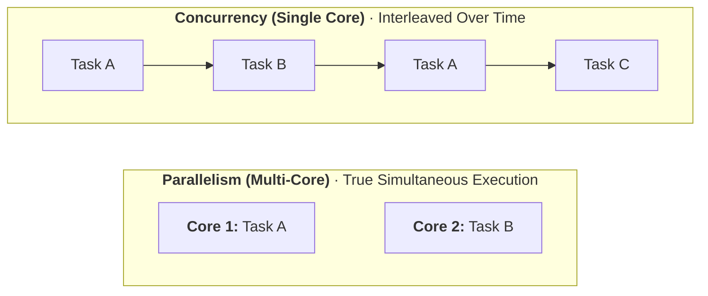
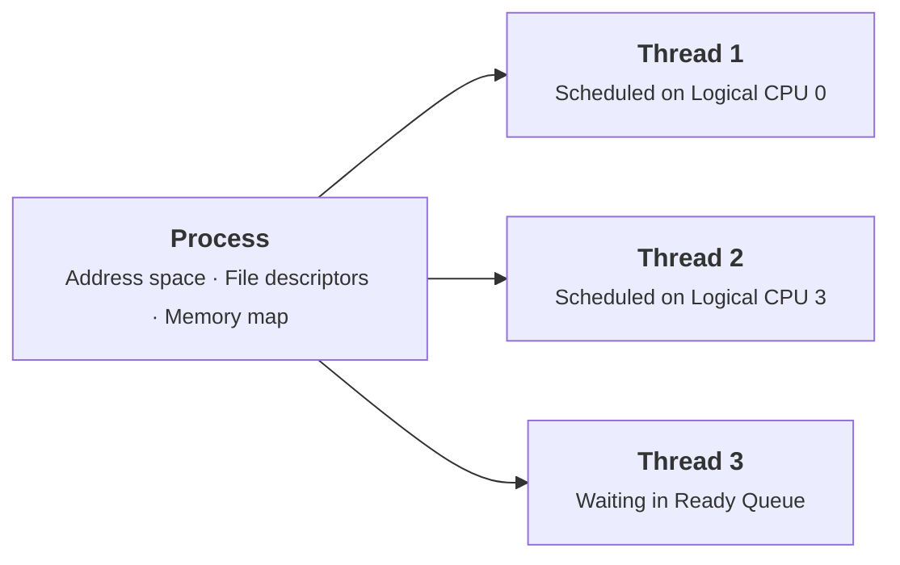
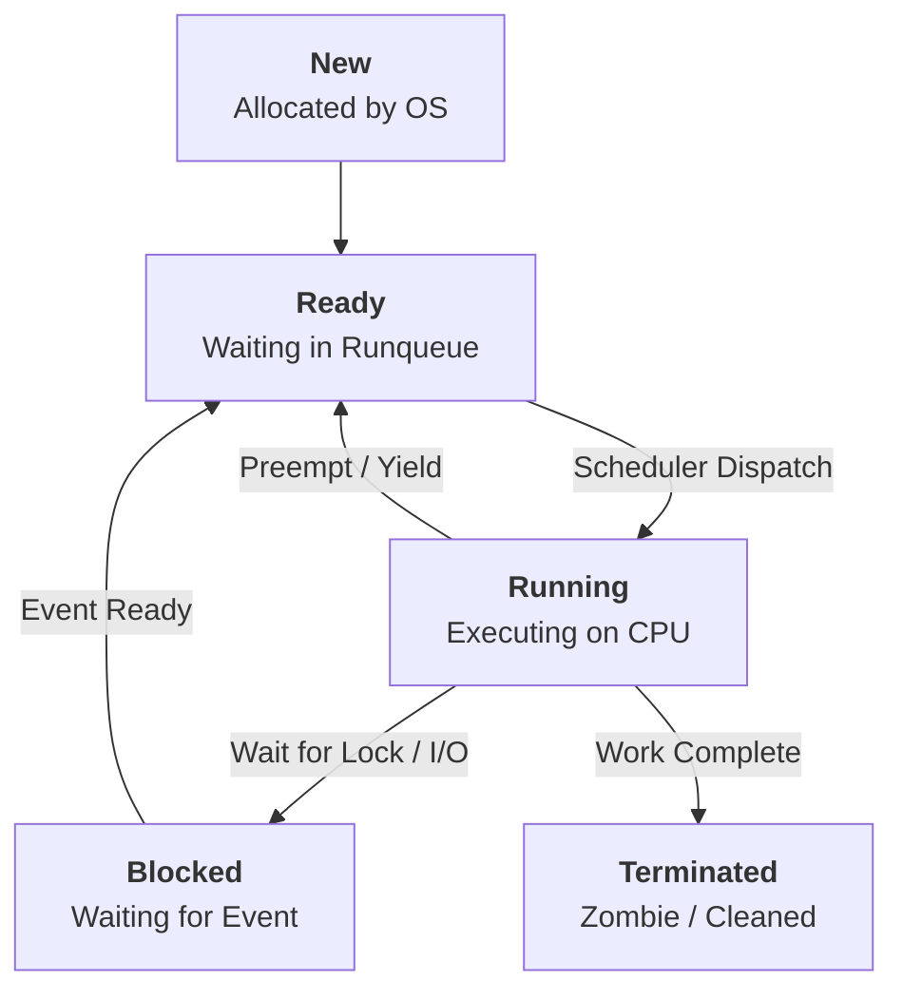
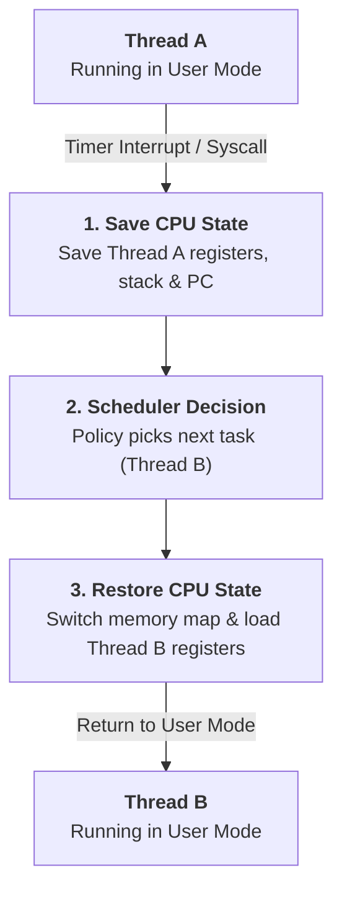
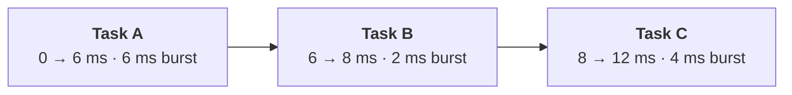
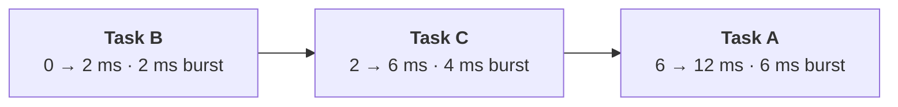
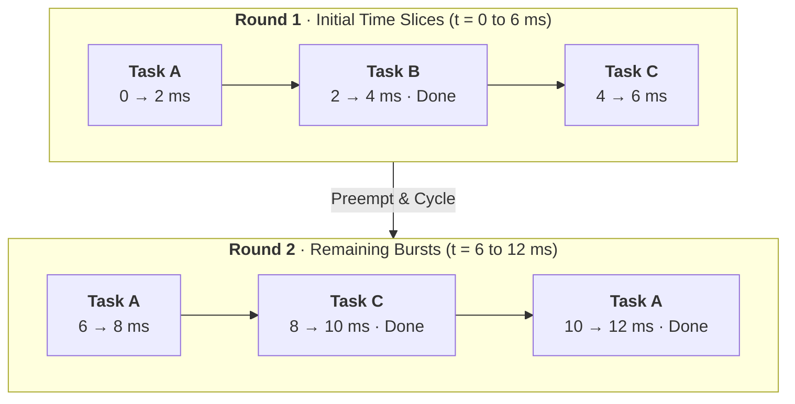

Have you ever opened Task Manager or Activity Monitor and stared at the sheer number of things your computer is doing? You might see 400 processes listed, yet your CPU only has 8 or perhaps 16 cores.

How does a computer run hundreds of tasks when it only has a handful of physical execution units to do the work?

The short answer is that it does not run all of them at the same time.

What looks like hundreds of simultaneous programs is an operating system illusion. The kernel rapidly coordinates work through a component called the **CPU scheduler**. Understanding how that illusion works requires looking beneath the surface at threads, hardware execution contexts, and scheduling queues.

---

## Concurrency vs. Parallelism

To make sense of how the operating system manages this workload, we first need to distinguish between **concurrency** and **parallelism**:

- **Concurrency** means managing multiple tasks by interleaving their progress. A single CPU core achieves concurrency by switching between tasks so quickly that they appear to run side by side.
- **Parallelism** means executing multiple operations at the exact same physical instant.

Here, hardware terminology matters. Physical cores, logical CPUs, hardware execution contexts, and instruction-level parallelism are distinct concepts:

- **Instruction-Level Parallelism (ILP):** Modern CPU cores are superscalar. Through pipelining and out-of-order execution, a single core can execute multiple independent instructions from the same thread in a single clock cycle across different execution units (such as arithmetic logic units, vector units, and load/store units). A logical CPU is therefore not restricted to executing one instruction at a time.
- **Physical Cores:** These are independent physical processing units on the chip, each equipped with its own instruction decoders, execution pipelines, and private caches.
- **Simultaneous Multithreading (SMT) and Logical CPUs:** On processors supporting SMT (such as Intel Hyper-Threading or AMD SMT), a single physical core exposes multiple **logical CPUs** by duplicating architectural state (such as registers and program counters) while sharing execution pipelines, caches, and memory interfaces. SMT allows execution units to stay busy when one thread stalls, but because threads on the same physical core contend for shared hardware execution resources, two logical CPUs do not equal the computational throughput of two distinct physical cores.
- **Architectures Without SMT:** On chip designs without SMT (such as Apple Silicon cores), each physical core exposes a single logical CPU.

True thread-level parallelism (running distinct thread instruction streams at the exact same physical moment) is bounded by the number of active logical CPUs. Everything beyond that hardware limit relies on concurrency.

---

## Programs, Processes, and Threads

To understand how the kernel organizes work, we need to distinguish three related concepts:

1. A **Program** is an inactive file on your drive containing compiled instructions and static data. It is a recipe sitting in a cookbook.
2. A **Process** is an active instance of that program loaded into memory. The operating system assigns each process an isolated virtual address space, file descriptors, security credentials, and system resources. It is the kitchen where the cooking happens.
3. A **Thread** is the actual unit of execution that the CPU core runs. A process begins with one thread (the main thread), but it can spawn more. All threads within a process share that process's address space and open files, but each thread maintains its own program counter, call stack, and register values.

When you look at your task monitor, the operating system scheduler is not assigning entire processes to CPU cores. It is scheduling **threads** (often referred to simply as tasks in kernel source code).

### Application Work Selection vs. Kernel Scheduling

It is worth distinguishing application-level design from kernel-level scheduling. Creating more threads does not automatically make an application faster. In fact, creating an excessive number of threads introduces substantial memory overhead for thread stacks, increases lock contention, and wastes processor cycles on unnecessary context switching.

Modern software architectures often separate logical units of work from physical threads:

- Applications use thread pools, asynchronous event loops, and worker queues to manage concurrency within their own code.
- The application decides _which piece of work_ gets submitted to a thread.
- The operating system scheduler decides _which runnable thread_ gets access to a physical CPU core and for how long.

### The PCB and TCB Conceptual Model

Textbooks often explain that the operating system tracks each process with a **Process Control Block (PCB)**, and each thread with a **Thread Control Block (TCB)**.

The classic analogy is a clipboard. When a chef leaves a kitchen station, they write down what they were doing on a clipboard: current recipe step, measured ingredients, and next actions. When they return, they pick up the clipboard and resume.

In real operating systems, this is a conceptual model rather than a single monolithic record. Modern kernels distribute this information across multiple specialized data structures. For example, the Linux kernel uses `struct task_struct` to represent every schedulable entity, linking to separate structures for memory management (`mm_struct`), file tables (`files_struct`), and architecture-specific thread hardware states (`thread_struct`).

---

## Runnable vs. Blocked: Why 400 Processes Don't Melt Your CPU

If your computer has 400 processes and thousands of threads, why does your CPU usage sit comfortably at 2% while idling?

Because the vast majority of those threads are not competing for CPU time. They are **blocked** or **sleeping**.

At any typical moment:

- Your music player thread is waiting for the audio buffer to request more samples.
- Your word processor is waiting for you to strike a key.
- A background backup service is waiting for an hourly system timer.
- Web browser helper threads are waiting for network packets to arrive.

A thread that is waiting for an external event consumes virtually zero CPU time. The kernel removes it from the active scheduling queues until that event occurs. Only **runnable** threads demand scheduler attention. On an idle system, the count of runnable threads is often lower than the number of available logical CPUs.

---

## Process and Thread States

Throughout its lifetime, a thread moves through several distinct states. While specific operating systems have their own internal state flags, standard operating system theory models five primary states:

1. **New:** The operating system allocates memory, initializes control structures, and prepares the initial thread.
2. **Ready:** The thread has satisfied all software execution prerequisites and is placed on a runqueue waiting for an available core. However, being ready does not guarantee that all of the thread's virtual memory pages are currently resident in physical RAM. Virtual memory relies on demand paging; if pages have not yet been loaded or were paged out, the thread will trigger page faults when it touches them.
3. **Running:** The thread is actively executing instructions on a logical CPU.
4. **Blocked (Waiting):** The thread cannot execute, even if cores sit idle, because it is waiting on an external event, a synchronization lock, or an operating system operation.
   - Not every wait is voluntary. A thread might voluntarily sleep, but it can also be blocked involuntarily when waiting on a contested mutex or during a major page fault that requires reading data from disk or network storage. (By contrast, minor page faults, such as allocating fresh zeroed pages or copy-on-write mappings, are resolved immediately in memory by the kernel without blocking the thread for disk I/O).
   - A blocked thread becomes runnable when its awaited event completes. While hardware interrupts signal external completions (such as a disk controller finishing a transfer or a network card receiving data), many wake-up events are internal kernel operations. For instance, another thread on a different core might release a lock, post to a semaphore, or write to a pipe. In all cases, the kernel updates the task's state descriptor and moves it back to the **Ready** queue, never directly into Running.
5. **Terminated (Exited):** The thread has completed execution or was killed. In Unix-like systems, a terminated process remains as a "zombie" entry in the process table until its parent process reads its exit status using a system call such as `wait()` or `waitpid()`. Once the parent collects this status, the process's remaining kernel structures are freed.

---

## Context Switching and Preemption

How does the CPU actually transfer execution from one thread to another? It carries out a **context switch**.

A context switch consists of two separate phases:

1. **The Policy Decision:** The scheduler algorithm examines runnable tasks and selects the next thread to dispatch.
2. **The Switch Mechanism:** The kernel saves the hardware register state (instruction pointer, stack pointer, general-purpose registers) of the outgoing thread, updates memory management pointers if switching across different processes, and restores the saved hardware registers of the incoming thread.

### The Cost of Switching: Direct vs. Indirect Overhead

Context switching imposes both direct administrative costs and indirect architectural penalties:

- **Direct Switching Overhead:** This represents the processor cycles spent executing kernel instructions to save and restore architectural registers, switch kernel execution stacks, and change virtual memory page directory pointers. While necessary, this direct overhead represents pure administrative cost during which no application code advances.
- **Indirect Architectural Overhead:** Often more significant than direct register saving is the disruption to hardware caches and memory translation caches. When switching between threads of different processes, virtual memory mappings change. Although modern processors use tagged translation lookaside buffers (PCID on x86, ASID on ARM) to reduce full TLB flushes, the newly scheduled thread will still encounter initial L1 and L2 cache misses as it pulls its own working data into the processor's memory hierarchy.

Context switch costs vary substantially depending on what is being switched. Switching between two threads within the same process avoids an address-space switch entirely, keeping page tables and memory mappings intact. Furthermore, if a thread was only preempted for a brief period and returns to the same core, a substantial portion of its working data may still reside warm in local CPU caches.

### Preemption and Hardware Timers

Early desktop operating systems relied on **cooperative multitasking**. A running program had to voluntarily surrender control of the CPU by yielding or invoking a system call. If an application entered an infinite loop, the entire machine locked up.

Modern operating systems rely on **preemptive multitasking**, where the kernel retains the authority to interrupt and suspend running tasks.

To achieve this, the kernel configures hardware timers. When a timer interrupt fires:

1. The hardware pauses user execution and transfers control to the kernel interrupt handler.
2. The kernel updates runtime accounting for the current task.
3. The scheduler checks whether the task has exceeded its time slice or if a higher-priority task has become runnable, setting a rescheduling flag (such as `need_resched` in Linux).

Crucially, a timer interrupt does not force an immediate context switch on every tick. If the current thread has remaining time allowance and no higher-priority task is waiting, the kernel leaves the thread running and returns to user space.

### Tickless Kernels: Idle vs. Full

Modern operating systems do not rely exclusively on fixed periodic timer ticks. In the Linux kernel, timer behavior is governed by specific configuration models:

- **`CONFIG_NO_HZ_IDLE` (Omit ticks on idle CPUs):** In standard desktop and server distributions, this is the default mode. When a CPU core becomes idle with no runnable tasks, the kernel omits periodic scheduling-clock interrupts on that core, allowing it to enter deeper low-power sleep states until an external interrupt or scheduled timer arrives.
- **`CONFIG_NO_HZ_FULL` (Full tickless / adaptive ticks):** This more specialized configuration extends tick omission to non-idle CPUs that have only a single runnable task. If a core is running one compute-bound workload without competition, periodic ticks can be disabled to eliminate OS jitter. However, this capability is not enabled by default in standard general-purpose kernels. It requires explicit kernel configuration, dedicated boot parameters (`nohz_full`), and ongoing maintenance of residual kernel housekeeping threads, making it primarily useful for high-performance computing (HPC) and hard real-time systems.

---

## A Worked Example: How Scheduling Policies Change Outcomes

To see why scheduling policies matter, let us look at a concrete numerical example.

### The Setup and Assumptions

Suppose a single CPU core receives three runnable tasks (A, B, and C) that all arrive at time $t = 0$ in the order A, B, C.

- **Task A:** Requires 6 ms of CPU burst time.
- **Task B:** Requires 2 ms of CPU burst time.
- **Task C:** Requires 4 ms of CPU burst time.

To keep the comparison transparent, we will use standard textbook assumptions:

- One single-core CPU with one hardware execution context.
- Burst lengths are fixed and known in advance.
- No task performs any I/O or blocks during execution.
- Context switch overhead is zero.

These are simplifying assumptions. In a production operating system, burst lengths cannot be known with certainty in advance, tasks interleave CPU work with I/O, and context switches take measurable time. Nonetheless, this baseline reveals how different policies behave.

We will evaluate two standard metrics:

- **Turnaround Time:** Total elapsed time from arrival to completion ($\text{Turnaround Time} = \text{Completion Time} - \text{Arrival Time}$).
- **Waiting Time:** Total time a task spends sitting in the ready queue before finishing. Under our specific assumptions (arrival at $t = 0$ and no I/O blocking), this simplifies directly to $\text{Waiting Time} = \text{Turnaround Time} - \text{Burst Length}$.

---

### Policy 1: First-Come, First-Served (FCFS)

FCFS runs tasks strictly in the order of their arrival until they finish.

- **Task A:** Starts at $t = 0$, finishes at $t = 6$.
  - Turnaround: $6 - 0 = 6$ ms. Waiting: $6 - 6 = 0$ ms.
- **Task B:** Starts at $t = 6$, finishes at $t = 8$.
  - Turnaround: $8 - 0 = 8$ ms. Waiting: $8 - 2 = 6$ ms.
- **Task C:** Starts at $t = 8$, finishes at $t = 12$.
  - Turnaround: $12 - 0 = 12$ ms. Waiting: $12 - 4 = 8$ ms.

**Averages:**

- Average Waiting Time: $(0 + 6 + 8) / 3 = 4.67$ ms.
- Average Turnaround Time: $(6 + 8 + 12) / 3 = 8.67$ ms.

Notice the penalty on Task B: a short 2 ms task was forced to wait 6 ms simply because a longer task got in line first. This delay is known as the **convoy effect**.

---

### Policy 2: Shortest Job First (SJF, Non-Preemptive)

SJF inspects the ready queue and selects the task with the shortest CPU burst length first. In our example, the execution order becomes B (2 ms), then C (4 ms), then A (6 ms).

- **Task B:** Starts at $t = 0$, finishes at $t = 2$.
  - Turnaround: $2 - 0 = 2$ ms. Waiting: $2 - 2 = 0$ ms.
- **Task C:** Starts at $t = 2$, finishes at $t = 6$.
  - Turnaround: $6 - 0 = 6$ ms. Waiting: $6 - 4 = 2$ ms.
- **Task A:** Starts at $t = 6$, finishes at $t = 12$.
  - Turnaround: $12 - 0 = 12$ ms. Waiting: $12 - 6 = 6$ ms.

**Averages:**

- Average Waiting Time: $(0 + 2 + 6) / 3 = 2.67$ ms.
- Average Turnaround Time: $(2 + 6 + 12) / 3 = 6.67$ ms.

Under these conditions, SJF provides the mathematically minimal average waiting time. Average waiting dropped from 4.67 ms to 2.67 ms.

---

### Policy 3: Round Robin (RR, Time Quantum = 2 ms)

Round Robin gives each task a fixed time slice (quantum) of 2 ms before preempting it and placing it at the back of the queue.

The execution sequence proceeds as follows:

1. $t = 0$ to $2$: Task A runs 2 ms (4 ms remaining).
2. $t = 2$ to $4$: Task B runs 2 ms (**Task B completes**).
3. $t = 4$ to $6$: Task C runs 2 ms (2 ms remaining).
4. $t = 6$ to $8$: Task A runs 2 ms (2 ms remaining).
5. $t = 8$ to $10$: Task C runs 2 ms (**Task C completes**).
6. $t = 10$ to $12$: Task A runs 2 ms (**Task A completes**).

- **Task B:** Completes at $t = 4$.
  - Turnaround: $4 - 0 = 4$ ms. Waiting: $4 - 2 = 2$ ms.
- **Task C:** Completes at $t = 10$.
  - Turnaround: $10 - 0 = 10$ ms. Waiting: $10 - 4 = 6$ ms.
- **Task A:** Completes at $t = 12$.
  - Turnaround: $12 - 0 = 12$ ms. Waiting: $12 - 6 = 6$ ms.

**Averages:**

- Average Waiting Time: $(6 + 2 + 6) / 3 = 4.67$ ms.
- Average Turnaround Time: $(12 + 4 + 10) / 3 = 8.67$ ms.

### Comparison Summary

| Metric                      |    FCFS     | Shortest Job First | Round Robin ($q = 2\text{ ms}$) |
| :-------------------------- | :---------: | :----------------: | :-----------------------------: |
| **Task A Waiting Time**     |    0 ms     |        6 ms        |              6 ms               |
| **Task B Waiting Time**     |    6 ms     |        0 ms        |              2 ms               |
| **Task C Waiting Time**     |    8 ms     |        2 ms        |              6 ms               |
| **Average Waiting Time**    | **4.67 ms** |    **2.67 ms**     |           **4.67 ms**           |
| **Average Turnaround Time** | **8.67 ms** |    **6.67 ms**     |           **8.67 ms**           |

While Round Robin produces the same average waiting time as FCFS in this idealized case, look at Task B: under FCFS, Task B sat stalled for 6 ms before taking its first step. Under Round Robin, Task B started at $t = 2$ and was completely finished at $t = 4$.

Round Robin prioritizes **responsiveness** and bounded delay over raw throughput.

---

## Classical Scheduling Algorithms in Practice

Operating systems researchers built upon these foundations to address real-world workloads. Beyond the idealized numerical examples above, each algorithm embodies specific operational trade-offs:

### 1. First-Come, First-Served (FCFS)

- **Selection Rule:** Tasks run strictly in arrival order from a FIFO queue until they voluntarily yield, block on I/O, or terminate.
- **Practical Use and Trade-offs:** FCFS requires minimal code and negligible scheduler bookkeeping. However, the convoy effect makes it unsuitable for interactive desktop environments. In modern operating systems, pure FCFS is typically reserved for specialized batch processing or simple embedded microcontrollers.

### 2. Round Robin (RR)

- **Selection Rule:** Runnable tasks cycle through a FIFO queue, each granted up to a fixed maximum time slice before being preempted to the back of the line.
- **Practical Use and Trade-offs:** Round Robin aims to share CPU time evenly among runnable tasks, but practical fairness is nuanced. Real applications mix short CPU bursts with frequent I/O blocks, meaning tasks that yield before their slice expires receive less continuous CPU time than purely compute-bound threads. The policy is sensitive to quantum sizing:
  - If the quantum is **too large**, the policy degenerates into FCFS, delaying interactive response.
  - If the quantum is **too small**, context switching overhead increases. While a small slice does not automatically waste most CPU cycles, excessive switching consumes processor time in the kernel and increases cache misses, reducing overall throughput.

### 3. Shortest Job First (SJF) and Shortest Remaining Time First (SRTF)

- **Selection Rule:** Non-preemptive SJF picks the task with the smallest CPU burst. Preemptive Shortest Remaining Time First (SRTF) will preempt a running task if a newly arrived task has a shorter remaining burst time.
- **Practical Use and Trade-offs:** Under the assumption of known burst durations, SJF provably minimizes average waiting time. However, general-purpose operating systems cannot know an arbitrary thread's future execution length in advance. Batch schedulers sometimes estimate future burst lengths using exponential smoothing over historical execution, but this remains an approximation. Furthermore, both SJF and SRTF suffer from **starvation**: if short tasks arrive continuously, long tasks may wait indefinitely.

### 4. Multi-Level Feedback Queue (MLFQ)

- **Selection Rule:** The scheduler maintains multiple distinct priority queues. Tasks in higher-priority queues are serviced first. Within a single queue, tasks are typically scheduled using Round Robin.
- **Dynamic Adaptation:** MLFQ accommodates mixed workloads without advance knowledge of burst lengths:
  - New tasks enter at the highest-priority queue with a short time quantum.
  - If a task uses its entire time slice without yielding, it is classified as CPU-bound and demoted to a lower-priority queue with a longer quantum.
  - If a task voluntarily yields before its slice expires, it remains in a high-priority queue, ensuring interactive I/O tasks stay responsive.
- **Trade-offs and Mitigation:** MLFQ represents a family of heuristics requiring careful parameter tuning:
  - **Starvation:** Long CPU-bound tasks in lower queues can starve if new interactive tasks continuously occupy top queues. Real systems mitigate this using a periodic **priority boost**, resetting all tasks back to the top queue after a fixed duration.
  - **Gaming Resistance:** In basic MLFQ designs, a thread could attempt to game the scheduler by yielding just before its time slice expires to retain high priority while consuming substantial CPU time over multiple slices. Real-world implementations mitigate this through accounting strategies, such as tracking a task's cumulative execution time within a given priority level rather than resetting its allowance upon every voluntary yield. However, because heuristic policies vary across implementations, tuning priority thresholds and boost intervals remains a pragmatic balancing act.

---

## Modern Schedulers: Linux and Apple Silicon

Modern operating systems adapt these classical principles to handle multi-gigabyte memories, dozens of hardware execution contexts, and heterogeneous core architectures.

### Linux: CFS and the Transition to EEVDF

For over fifteen years (from Linux 2.6.23 in 2007 through kernel 6.5 in 2023), the default scheduler for standard Linux tasks was the **Completely Fair Scheduler (CFS)**.

CFS did not use fixed time slices. Instead, it modeled an ideal multi-tasking CPU where every runnable task makes continuous, proportional progress. CFS tracked this using **virtual runtime** (`vruntime`):

- A task's `vruntime` increases as it spends physical time running on a core.
- Tasks with higher priority (lower "nice" values) accumulate `vruntime` more slowly than lower-priority tasks.
- CFS stored all runnable tasks in a time-ordered red-black tree, always picking the task with the smallest `vruntime`.

While CFS delivered proportional throughput fairness over long windows, managing interactive latency required complex heuristics, such as latency sensitivity knobs and sleeper bonuses.

Starting in **Linux kernel 6.6** (released in late 2023), Linux evolved its fair scheduling class by replacing CFS's pick logic with **EEVDF** (Earliest Eligible Virtual Deadline First), developed by kernel maintainer Peter Zijlstra based on Peter Hoon's 1995 scheduling model:

1. **Retaining Proportional Foundations:** EEVDF keeps the underlying virtual runtime and priority weighting architecture of CFS. It continues to aim for fair CPU distribution based on task weights.
2. **Eligibility via Lag:** EEVDF introduces a formal concept of **lag**, which measures the difference between the service a task should have received under an ideal fair allocation and what it actually consumed. A task with positive lag is owed CPU time; a task with negative lag has consumed more than its fair share. A task is considered **eligible** to run only when its lag is greater than or equal to zero. This stops tasks that recently monopolized the core from preempting others prematurely.
3. **Selection via Virtual Deadlines:** Among all eligible tasks, EEVDF selects the task with the earliest **virtual deadline**. A task's virtual deadline represents the point in virtual time by which it should complete its current requested slice ($vruntime + \text{virtual slice}$, where virtual slice is scaled by the task's weight). Latency-sensitive tasks can request shorter time slices (using system interfaces like `sched_setattr`), which places their virtual deadlines earlier and allows them to preempt batch tasks.

It is critical to distinguish EEVDF virtual deadlines from hard real-time deadlines. In EEVDF, a virtual deadline is an internal ordering heuristic within the **fair scheduling class** (`SCHED_NORMAL`, `SCHED_OTHER`, and `SCHED_BATCH`) designed to improve responsiveness for desktop and interactive tasks. Linux handles strict, guaranteed timing requirements through dedicated real-time scheduling classes (`SCHED_FIFO`, `SCHED_RR`) and deadline scheduling (`SCHED_DEADLINE`), which take precedence over EEVDF.

### Apple Silicon: Heterogeneous Scheduling and Quality of Service

Modern Apple devices (Mac, iPhone, iPad) utilize an asymmetric multiprocessing (AMP) architecture. Apple Silicon chips combine two distinct core types on the same die:

- **Performance Cores (P-cores):** Wide-decode, high-frequency execution pipelines with large private caches optimized for raw single-thread speed at higher energy cost.
- **Efficiency Cores (E-cores):** Narrower, power-efficient pipelines designed to handle background and maintenance workloads while using a fraction of the energy.

To coordinate tasks across asymmetric cores, the macOS scheduler does not rely on static core assignment rules. Instead, it evaluates **Quality of Service (QoS)** classes assigned to dispatch queues and threads.

As documented in Apple Developer guidelines, QoS classes express the relative importance and latency sensitivity of application work:

- **`UserInteractive`:** High-priority work driving the active user interface, animations, or immediate input processing.
- **`UserInitiated`:** Work explicitly requested by the user where progress is actively expected before continuing, such as opening a selected document.
- **`Default` and `Utility`:** Work progressing without directly blocking active user interactions, such as long computations, data imports, or file downloads.
- **`Background`:** Low-priority maintenance, database indexing, and synchronization activities where energy efficiency is prioritized over completion time.

Crucially, QoS classes communicate operational intent rather than strict core-placement contracts. Core allocation remains dynamic:

- The XNU kernel scheduler treats QoS levels as strong inputs to its placement heuristics, but it continuously balances them against broader system telemetry.
- Core selection factors in overall system workload, the balance between throughput and energy consumption, current thermal headroom, and whether the device is operating on battery power or connected to an external power supply.
- Work from any QoS category may execute on performance or efficiency cores as the kernel continuously adjusts its allocation policies to maintain both interactive responsiveness and overall energy efficiency.

---

## The Illusion That Works

The next time you open your system monitor and see hundreds of processes coexisting peacefully while your applications respond immediately, you are seeing a multi-tiered architecture in action:

1. **Threads** break programs into dispatchable streams of execution.
2. **Blocked states** ensure that dormant tasks consume virtually zero CPU time.
3. **Hardware timers and preemption** maintain kernel authority and prevent runaway loops from monopolizing cores.
4. **Modern schedulers** balance long-term execution fairness with immediate interactive responsiveness across complex, asymmetric hardware.

The illusion of seamless multi-tasking is not magic. It is the result of continuous, disciplined coordination between hardware execution units and operating system scheduling policies.

---

## References and Further Reading

- **Linux Kernel Documentation: Scheduler Overview**\
  [https://docs.kernel.org/scheduler/](https://docs.kernel.org/scheduler/)
- **Linux Kernel Documentation: CFS Scheduler Design**\
  [https://docs.kernel.org/scheduler/sched-design-CFS.html](https://docs.kernel.org/scheduler/sched-design-CFS.html)
- **Linux Kernel Documentation: EEVDF Scheduler**\
  [https://docs.kernel.org/scheduler/sched-eevdf.html](https://docs.kernel.org/scheduler/sched-eevdf.html)
- **Linux Kernel Documentation: NO_HZ Reducing Scheduling-Clock Ticks**\
  [https://docs.kernel.org/timers/no_hz.html](https://docs.kernel.org/timers/no_hz.html)
- **Apple Developer Documentation: Tuning Your Code's Performance for Apple Silicon**\
  [https://developer.apple.com/documentation/apple-silicon/tuning-your-code-s-performance-for-apple-silicon/](https://developer.apple.com/documentation/apple-silicon/tuning-your-code-s-performance-for-apple-silicon/)
- **Apple Developer Documentation: Prioritizing Work with Quality of Service Classes**\
  [https://developer.apple.com/documentation/dispatch/dispatchqos](https://developer.apple.com/documentation/dispatch/dispatchqos)
