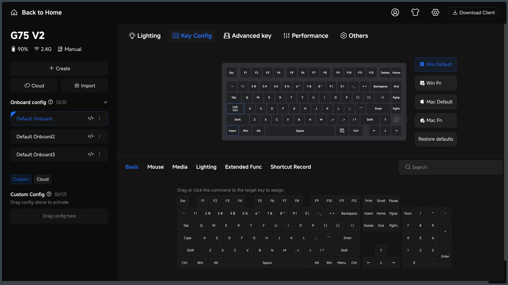

Modern mechanical keyboards and gaming mice often ship with web-based drivers that run directly in Chromium-based browsers using the **WebHID** (Human Interface Device) API. Instead of installing vendor-specific proprietary desktop software, you can remap keys, adjust DPI/polling rates, customize RGB, and tweak debounce settings right through a web page.

On Linux, however, these web drivers almost always fail to detect your hardware out of the box. Chromium cannot communicate with the device because Linux restricts access to raw HID character devices (`/dev/hidraw*`) to `root` by default.

To let your user session interface with your peripherals without running your browser as root, you need to add custom `udev` rules.

> **Note:** While this guide uses the **Mchose G75 v2** as a concrete walkthrough, this workaround is universal. The exact same mechanism works for most keyboards and mice using web configurators—including the **Aula F75** variants, **Ajazz AK820** variants, and others. All you need are the device's Vendor and Product IDs.

## 

## 1. Device Identifiers

The Mchose G75 v2 exposes different USB product IDs depending on whether you connect it with the USB-C cable or via the 2.4GHz wireless dongle:

- **Vendor ID:** `3837`
- **Wired Product ID:** `2021`
- **2.4GHz Dongle Product ID:** `3033`

Run `lsusb` in your terminal to inspect connected USB devices and find out your device's identifiers:

```bash
lsusb
```

Look for the entry corresponding to the keyboard or receiver (vendor ID `3837` with product ID `2021` or `3033`).

## 

## 2. Writing the udev Rules

Create a new udev rule file in `/etc/udev/rules.d/`:

```bash
sudo nano /etc/udev/rules.d/99-mchose-g75v2.rules
```

Add the following rules:

```udev
# Mchose G75 v2 - Wired Mode
KERNEL=="hidraw*", ATTRS{idVendor}=="3837", ATTRS{idProduct}=="2021", MODE="0666", TAG+="uaccess"

# Mchose G75 v2 - 2.4GHz Wireless Mode
KERNEL=="hidraw*", ATTRS{idVendor}=="3837", ATTRS{idProduct}=="3033", MODE="0666", TAG+="uaccess"
```

### Breaking Down the Rule

- `KERNEL=="hidraw*"`: Matches the raw HID device nodes created under `/dev/`.
- `ATTRS{idVendor}=="3837"`: Filters for the vendor ID identified via `lsusb` (replace with your peripheral's vendor ID if using an Aula, Ajazz, or other device).
- `ATTRS{idProduct}=="2021"` / `"3033"`: Matches the product ID for wired or 2.4GHz wireless dongle mode.
- `MODE="0666"`: Grants read/write permissions to all users.
- `TAG+="uaccess"`: Flags the device for `systemd-logind` so the active, locally logged-in user automatically gets access control list (ACL) permissions.

If you are setting this up for a different keyboard or mouse (like an **Aula F75** or **Ajazz AK820** variant), keep the structure identical and simply substitute their respective `idVendor` and `idProduct` values.

---

## 3. Reloading and Applying Rules

Once you save the file, tell `udev` to reload its rule database and trigger the updated attributes on currently connected devices:

```bash
sudo udevadm control --reload-rules && sudo udevadm trigger
```

Alternatively, unplug the keyboard or 2.4GHz receiver and plug it back in.

---

## 4. Connecting via the Web Driver

1. Open a Chromium-based browser (Google Chrome, Chromium, Brave, or Microsoft Edge).
2. Navigate to the driver section on the official website. This is the [Official Driver](https://www.mchose.store/pages/mchose-hub) website.
3. Click to open the web driver interface and select **Connect**.
4. A browser permissions popup will prompt you to grant access. Select the device and confirm.

Your browser should now successfully read and write configuration profiles to the onboard memory.

> This is still a janky solution. So be patient of the laggy UI.

---

## Troubleshooting

- **Device still not appearing in the browser:**
  Verify that the device node received the correct permissions:

  ```bash
  ls -la /dev/hidraw*
  ```

  Check the ACL permissions using `getfacl` (where `X` is the assigned device number, such as `0`, `1`, `2`, `3`...):

  ```bash
  getfacl /dev/hidrawX
  ```

  You should see your username granted `rw-` access under the ACL entries.

- **Using Firefox:**
  Firefox does not currently support the WebHID specification. Use a Chromium-based browser when configuring hardware profiles.

- **Bluetooth Mode:**
  Bluetooth connections communicate differently and rely on Web Bluetooth rather than `hidraw` udev rules. When remapping keys or updating firmware, stick to wired or the 2.4GHz dongle.
