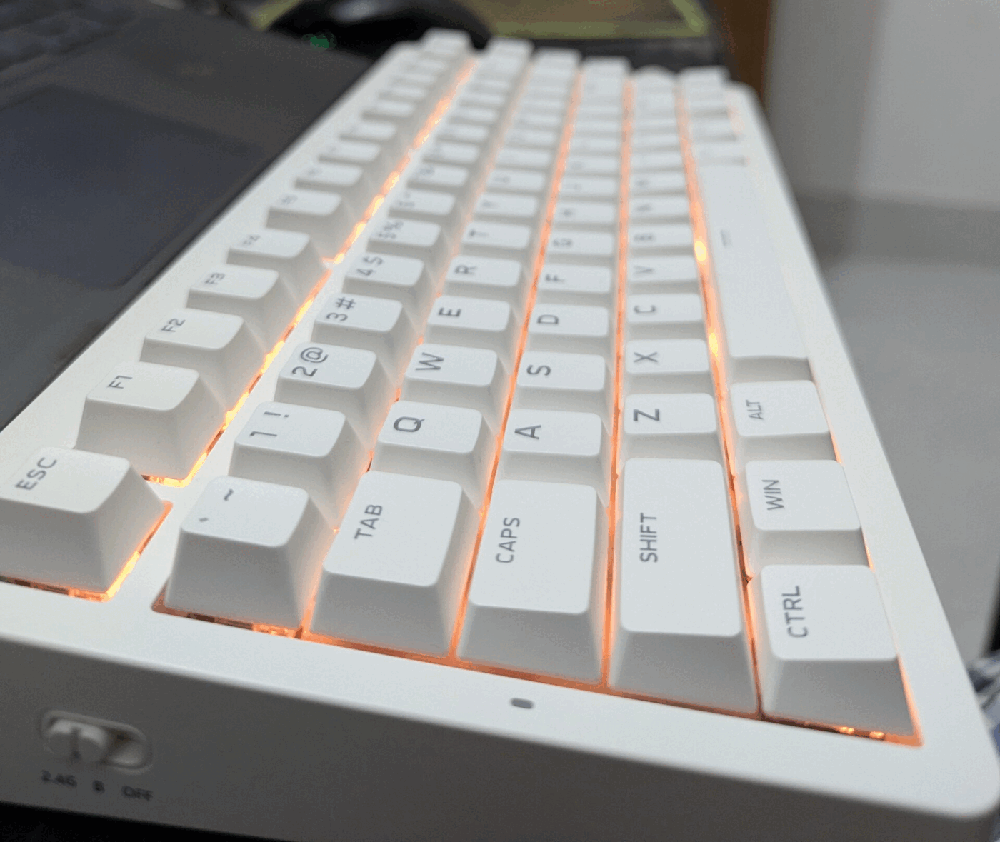
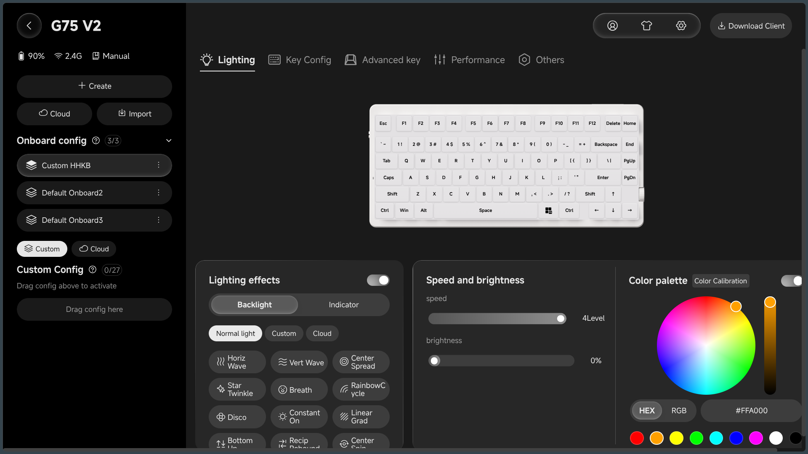
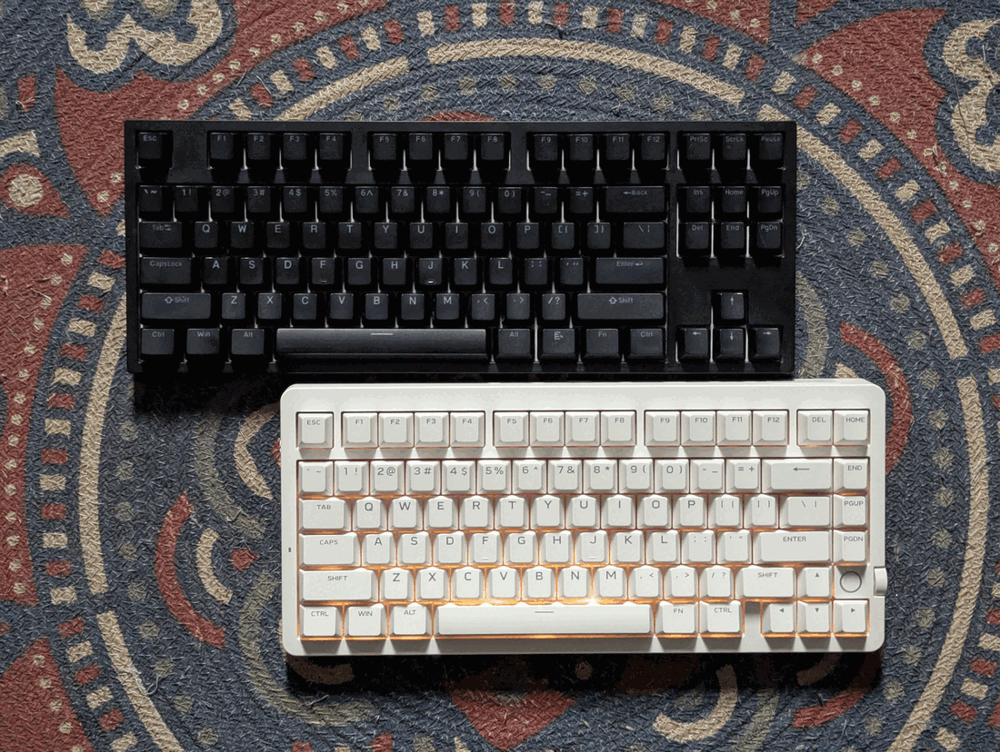

My previous mechanical keyboard was a Ganss GS3087T-Li. I bought it from [Cybertronics BD](https://cybertronicsbd.com/) in November 2023, and it was my daily driver for nearly three years. It was a TKL keyboard with 87 keys, and I was perfectly happy with it. Unfortunately, its PCB eventually died.

I spent a week researching possible repairs, but ordering a replacement PCB from China would have cost more than buying another keyboard. So I started looking for a replacement. That eventually led me to the MCHOSE G75 V2.

I've been using the Star Core White variant with Quick Gold V3 switches since October 29. I spend around 10 hours a day typing and working at my computer, so it gets plenty of use. Here's how it has been so far.

## Choosing the G75 V2

I ordered the keyboard from [Tech Diversity BD](https://techdiversitybd.com/) on October 28. The keyboard cost ৳6,000, plus ৳100 delivery, bringing the total to ৳6,100. Steadfast delivered it the following day. The packaging was good, with adequate bubble-wrap cushioning, and all the included accessories were present.

There were several alternatives in my budget. I could have gone for an AULA F75 or an AJAZZ AK820 variant around ৳5,000. I could also stretch my budget to around ৳8,500 for the Lucky65 V3, with its aluminium body and QMK/VIA support. MCHOSE also offered the G87 V2, a TKL alternative priced at ৳6,500. I considered it, but preferred the G75 V2's keycap design and wanted to try a smaller layout.

At around ৳6,000, the G75 V2 seemed to offer the most features for the price. The multifunction volume knob was a nice addition, and the Star Core White finish caught my attention. The small ring light near the bottom-right corner gives it a distinctive look. I don't care much about LED screens on keyboards, so I didn't see a reason to pay extra for one.

## The transition from TKL to 75%

The biggest adjustment has been the layout. My Ganss had 87 keys in a traditional TKL arrangement, with comfortable spacing around the navigation cluster. Everything felt familiar, and I rarely had to think about where my fingers were going.

The G75 V2 has a more compact 75% layout with 78 keys. It keeps the function row, arrow keys and navigation keys while bringing everything closer together. That saves desk space, but it also means adjusting old muscle memory. I occasionally hit the Up Arrow when I intend to press right Shift. It's not a major issue, and I'm sure I'll adapt, but the transition hasn't been seamless.

I still find TKL the most comfortable layout. That said, the 75% arrangement is growing on me.

## Typing experience and sound

The first thing I noticed was how light and fast the G75 V2 felt. The Quick Gold V3 switches are linear, and typing felt noticeably quicker than on my old board. At first, they were almost too fast for my taste. After using them consistently, I've become comfortable with them.

I still make occasional typing mistakes, but I attribute those mostly to the new layout and key positions. I haven't experienced finger fatigue or discomfort, even during long work sessions.

The keycaps are another improvement. The Ganss came with OEM-profile ABS keycaps, while the G75 V2 has MDA-profile PBT keycaps. I find the new ones considerably better to type on.

I'd describe the sound as deep clacky, but not quite thocky. There's some depth to each keystroke, although it doesn't have the especially deep, muted sound some enthusiasts look for. The gasket-mounted structure and internal acoustic filling make for a pleasant typing experience. I haven't modified anything; the keyboard is completely stock.

## Build quality and features

For a plastic-case keyboard, the build quality is surprisingly solid. It feels sturdy, with minimal case flex despite the gasket-mounted structure. Nothing about it feels particularly cheap, and the overall finish gives it a more premium impression than its price might suggest.

The G75 V2 supports USB wired, 2.4GHz wireless and Bluetooth connections. I primarily use the 2.4GHz dongle. Wired is technically the fastest, but I genuinely cannot tell the difference between wired and 2.4GHz in everyday use. Bluetooth feels slower, although it is still perfectly adequate for typing. I probably wouldn't choose it for competitive gaming.

The 10,000mAh battery is a big step up from the 3,000mAh battery in my old Ganss. I haven't needed to recharge it yet, and the indicator still shows around 90%. I can't say how accurate that reading is, so this isn't a proper battery-life test. Since I touch-type and don't need the RGB lighting on, my usage probably isn't particularly demanding.

The multifunction knob controls volume by default, and the web-based M HUB software lets me remap keys, configure the knob and customise other settings. I've remapped Caps Lock to Left Ctrl and Left Ctrl to Insert because those are positions I use regularly. The keyboard also has gaming-oriented options, including an 8,000Hz polling rate and adjustable debounce settings. I've enabled the polling-rate and debounce options, but left most of the other features untouched. I simply don't need them for my daily workload.

### Using the web driver on Linux

As a Linux user, getting the web-based configurator to recognise the keyboard wasn't entirely straightforward. The web driver didn't work out of the box on my setup because Linux restricts access to raw HID devices (`/dev/hidraw*`) by default.

I got it working by configuring `udev` rules to grant my user permission to access the keyboard's HID device. After that, a Chromium-based browser could communicate with the keyboard, so I could configure it without installing a separate desktop application.

I wrote a separate guide explaining the process, including the device identifiers, `udev` rules and browser configuration: [Making Keyboard and Mouse Web Drivers Work in Linux](https://sazidmahmud.bd/posts/13-making-keyboard-and-mouse-web-drivers-work-in-linux/).

The web driver itself is good and provides pretty much everything I expect from the manufacturer's software. My main complaint is the lack of QMK/VIA support. An open and widely supported configuration ecosystem would make an otherwise excellent keyboard even better.

## Ganss GS3087T-Li vs MCHOSE G75 V2

My Ganss was a great keyboard. It was my first mechanical keyboard, and I had no major complaints about its typing experience. Occasionally, dust would get underneath switches and cause them to stop registering. Moving those switches to different positions on the board usually fixed the problem. Eventually, though, the PCB gave up.

Considering that I used it for around 10 hours a day, it served me well for a budget mechanical keyboard. The G75 V2 feels like a step forward in most hardware aspects: a more refined build, better keycaps, more features and wireless connectivity.

The one area where I still prefer the Ganss is its TKL layout. The spacing around its navigation keys felt more natural, and I'm still adapting to the compact arrangement. That's a matter of personal preference rather than a flaw in the G75 V2.

## Final thoughts

MCHOSE has put together a compelling package with the G75 V2. For ৳6,100 including delivery, it's hard to complain about what it offers: a solid gasket-mounted build, PBT keycaps, smooth linear switches, tri-mode connectivity, a large battery, a multifunction knob and extensive software customisation.

I'd like to see QMK/VIA support in a future revision, and I still prefer the TKL layout. Even so, the 75% arrangement has its advantages once you get accustomed to it.

Would I recommend it? Absolutely. For someone buying their first mechanical keyboard, it's an excellent starting point. It's also a capable everyday workhorse for more experienced users who want plenty of features without spending a fortune.

The Ganss GS3087T-Li was a keyboard I genuinely enjoyed using. The MCHOSE G75 V2 is a more capable replacement, even if I still miss the layout of my old board. So far, I'm happy with the transition.
