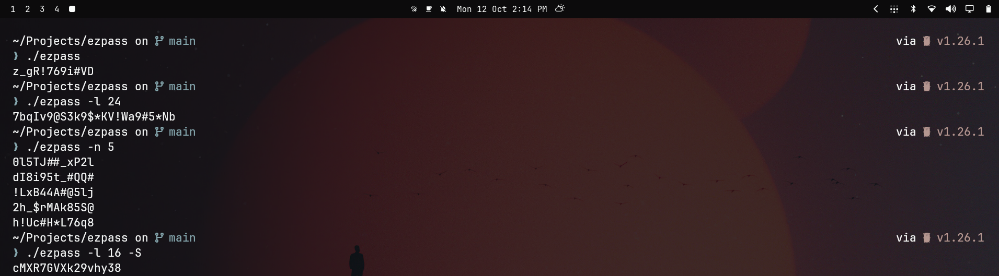

I wanted a simple way to generate strong passwords directly from my terminal, without depending on a bulky application or extra tools. So I built **ezpass**, a small password generator written in Go.

It generates cryptographically secure passwords with customizable lengths and character sets, but I wanted to go a little further than that. You can also generate memorable, Diceware-style passphrases, avoid confusing characters like `0` and `O`, copy passwords straight to your clipboard, and check their estimated strength and entropy.

One thing I particularly like about this project is that it stays lightweight. It uses Go's standard library without external dependencies, works nicely with shell scripts and pipelines, and can even be imported as a package into other Go projects. The goal was to make something practical that fits naturally into a terminal-based workflow.

Building `ezpass` has been a good exercise in thinking beyond just making something work. It gave me a chance to explore cryptographic randomness, password entropy, command-line interface design, and the little details that make a developer tool convenient to use.

It's a small project, but that's exactly what I wanted: a focused utility that solves a real problem without getting in the way.

**Source:** [GitHub](https://github.com/schlafer/ezpass)
