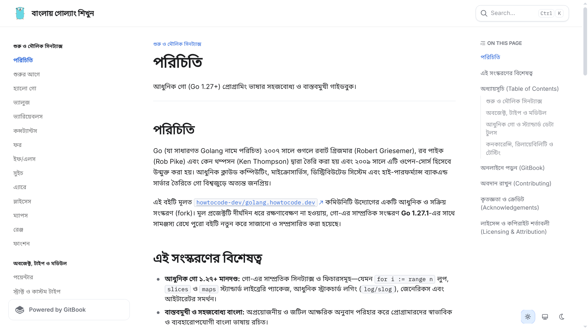

English documentation for Go is easy enough to find, but picking up a language—especially concepts like concurrency and interfaces—feels much more intuitive in your own language. **Learn Go in Bangla** is an open-source guide for Bengali-speaking developers who want a clear, modern introduction to Go.

The project started as a fork of [golang.howtocode.dev](https://github.com/howtocode-dev/golang.howtocode.dev), an older community guide that had been abandoned for years. Go has changed quite a bit since then, so I updated the material for Go 1.27+, reorganized the chapters, and covered newer features like generics, `slices` and `maps`, iterators, and structured logging (`slog`).

One of my main priorities was avoiding word-for-word translation. Translating technical vocabulary literally into Bengali usually results in awkward jargon that nobody actually uses. I wrote it the way programmers talk in practice, keeping standard industry terms in English and focusing on clear explanations.

Another common problem with online tutorials is stale code that stops working after a few compiler releases. To keep the guide reliable, I added an automated test suite to the repository that compiles and runs every single code snippet in the book.

Across 31 chapters, the guide covers everything from syntax basics and data structures to goroutines, channels, HTTP servers, context, and testing. It's still an evolving project, but keeping the material fresh and working has been a rewarding way to give back to the community.

**Source:** [GitHub](https://github.com/schlafer/learn-golang-in-bangla) · [Read the guide](https://golang.sazidmahmud.bd)
