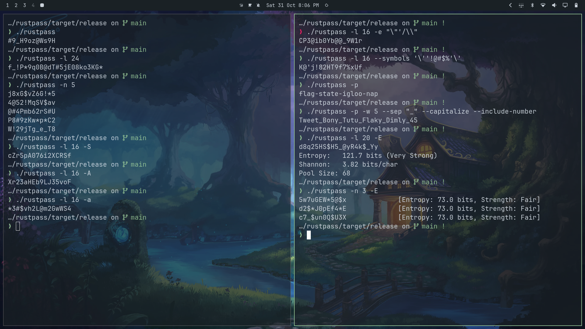

After putting together `ezpass` in Go, I wanted to rewrite the idea in Rust. I wanted something faster with better control over memory and randomness, so I built **rustpass**, a command-line password and passphrase generator.

It handles standard passwords and Diceware-style passphrases using the operating system's random number generator. If you ask for a mix of uppercase, lowercase, numbers, and symbols, it guarantees you get at least one of each and shuffles the final string with Fisher-Yates. You can also pick from presets like `strict` or `memorable`, or pass `--min-entropy` to let it figure out how long the password needs to be for the security level you want.

I also focused on small details that make CLI tools nice to use. You can copy passwords straight to your clipboard, and it falls back to OSC 52 escape codes so copying still works over SSH. If you do not want secrets printed to your screen or saved in terminal history, `--copy-only` copies to clipboard quietly. For scripts, you can format the output as JSON, turn off trailing newlines, or generate shell completions.

Writing it in Rust gave me a chance to dig into a few interesting topics. I used the `zeroize` crate to wipe passwords from memory as soon as they go out of scope, worked through the math for calculating entropy, and set things up so the code works as both a standalone tool and a library you can import into other Rust projects.

It is a simple tool, but it does what I need: it generates strong passwords quickly, keeps them off my screen, and fits right into my daily terminal workflow.

**Source:** [GitHub](https://github.com/schlafer/rustpass)
